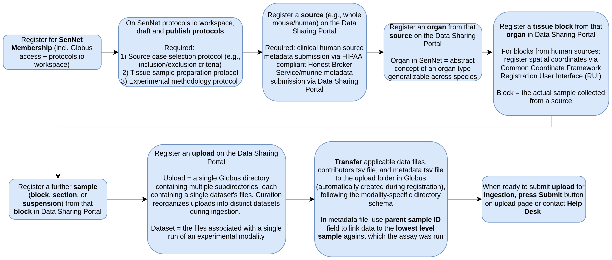

# Getting Started with Data Submission

Are you new to the data submission process in SenNet or looking for a refresher? This page provides an overview of the steps involved in preparing, submitting, and publishing your data, along with recommendations for making your data more findable and reusable by the scientific community.

For detailed instructions, see the [SenNet Data Submission Guide](/data-submission). The latest metadata and directory specifications are available through the [HuBMAP Metadata Reporting Standards](https://docs.hubmapconsortium.org/metadata), which are also used by SenNet for most assay types. SenNet maintains a [separate murine source metadata specification](https://docs.sennetconsortium.org/registration/schemas/source-murine/).

## On This Page

1. [Confirm access to the required resources](#step-1-access)
2. [Publish your experimental protocols](#step-2-protocols)
3. [Register your sources and samples](#step-3-register)
4. [Submit source and sample metadata](#step-4-source-sample-metadata)
5. [Prepare your experimental data and metadata](#step-5-prepare-data)
6. [Validate your metadata and file organization](#step-6-validate)
7. [Create your data upload and transfer your files](#step-7-upload)
8. [Respond to validation and processing results](#step-8-ingest)
9. [Review and approve your datasets for publication](#step-9-approval)

## Data Submission Checklist

The following steps describe a typical SenNet submission, from initial preparation through publication.

### 1. Confirm access to the required resources
{: #step-1-access }

Before beginning, make sure you have access to:

- The [SenNet Data Sharing Portal](https://data.sennetconsortium.org/).
- [Globus](https://www.globus.org/), using an institutional account authorized to access your group's submission directories.
- The [SenNet Method Development Community](https://www.protocols.io/workspaces/cellular-senescence-network-sennet-method-develo) on protocols.io.

If you do not have the necessary access, contact the [SenNet Help Desk](mailto:help@sennetconsortium.org).

See [Data Submission Guide, Section 1](https://docs.sennetconsortium.org/data-submission/Section1.html) for additional prerequisites.

### 2. Publish your experimental protocols
{: #step-2-protocols }

SenNet uses protocols.io to document how biological materials are selected and prepared and how experiments are performed.

Three types of protocols are relevant:

- **Case selection protocols:** Describe how sources were selected, including inclusion and exclusion criteria.
- **Sample preparation protocols:** Describe how tissue samples were collected and prepared from their parent sources or samples.
- **Assay preparation protocols:** Describe the experimental procedures used to generate the data.

Publish the appropriate protocols in the [SenNet Method Development Community](https://www.protocols.io/workspaces/cellular-senescence-network-sennet-method-develo) on protocols.io and obtain their Digital Object Identifiers (DOIs). These DOIs are used when registering entities and preparing assay metadata.

Make sure that your protocols describe the procedures actually used to generate your samples and data. When procedures change, use the appropriate protocol version.

See [Data Submission Guide, Section 1](https://docs.sennetconsortium.org/data-submission/Section1.html).

### 3. Register your sources and samples
{: #step-3-register }

All experimental datasets must be associated with their biological origins.

In the [SenNet Data Sharing Portal](https://data.sennetconsortium.org/):

1. Check whether the relevant sources and samples have already been registered.
2. Register any missing sources, such as humans or mice.
3. Register the corresponding organs, tissue blocks, sections, suspensions, or other applicable samples.
4. Establish the correct parent-child relationships between these entities.
5. Record the assigned SenNet IDs for use in your metadata.

This establishes the provenance of the material used to generate each dataset. Avoid registering duplicates of existing entities.

For applicable tissue blocks, complete spatial registration using the Human Reference Atlas Registration User Interface (RUI).

See [Entity Registration](/registration), [Data Submission Guide, Section 2](https://docs.sennetconsortium.org/data-submission/Section2.html), and [Section 4](https://docs.sennetconsortium.org/data-submission/Section4.html).

### 4. Submit source and sample metadata
{: #step-4-source-sample-metadata }

Source and sample metadata provide essential context about the biological material used in an experiment.

**Murine source metadata**

SenNet has a specific [murine source metadata schema](https://docs.sennetconsortium.org/registration/schemas/source-murine/). Complete the appropriate metadata template and upload it through the SenNet Data Sharing Portal.

Murine source metadata is necessary for the creation of dataset DOIs and associated descriptive information.

**Human source and clinical metadata**

Human source information follows a separate, secure submission process involving the CODCC and Pitt's Honest Broker workflow.

Clinical human source metadata must not be sent directly to the data curation team or through ordinary email. Contact the [SenNet Help Desk](mailto:help@sennetconsortium.org) to arrange access to the appropriate secure clinical-data Globus endpoint.

Human sources and their related samples must first be registered so the submitted clinical information can be associated with their SenNet IDs.

At minimum, human source metadata must include age, race, sex, and living/deceased status.

**Sample metadata**

Use the relevant metadata templates for tissue blocks, sections, suspensions, and other applicable sample types.

Accurate sample metadata is strongly encouraged because it helps researchers understand the biological context, preparation, and provenance of published datasets. Missing sample-level metadata does not automatically prevent publication, although individual submissions may have additional requirements.

See [Data Submission Guide, Section 3](https://docs.sennetconsortium.org/data-submission/Section3.html) and [Section 9: Clinical Human Metadata](https://docs.sennetconsortium.org/data-submission/Section9.html).

### 5. Prepare your experimental data and metadata
{: #step-5-prepare-data }

Each experimental dataset requires the files and metadata specified for its assay type.

Consult the [current metadata and directory specifications](https://docs.hubmapconsortium.org/metadata) before organizing your submission.

A conventional upload includes:

- **Assay metadata:** Describes the experimental modality, parent samples, relevant protocols, and other required experimental information.
- **Contributors metadata:** Identifies the individuals responsible for generating the data, including their affiliations and ORCID identifiers.
- **Antibody metadata and associated validation materials:** Required for applicable antibody-based assays.
- **Experimental data files:** The files required by the relevant assay directory specification.

For conventional multi-dataset uploads, organize the files into dataset-specific directories. Each row in the assay metadata corresponds to a dataset, and its `data_path` field identifies the corresponding directory.

Follow the assay-specific instructions if a different supported directory organization is specified.

See [Data Submission Guide, Section 5](https://docs.sennetconsortium.org/data-submission/Section5.html) and [Section 6](https://docs.sennetconsortium.org/data-submission/Section6.html).

### 6. Validate your metadata and file organization
{: #step-6-validate }

Before submitting the upload:

1. Validate your metadata spreadsheets using the [CEDAR Metadata Spreadsheet Validator](https://metadatavalidator.metadatacenter.org/).
2. Correct any reported metadata errors.
3. Verify that your metadata references the correct registered sources and samples.
4. Check that the files and directories match the applicable assay specification.
5. Confirm that each dataset's metadata points to the correct data files.

Successful spreadsheet validation does not necessarily mean that the complete upload will pass all downstream validation checks.

### 7. Create your data upload and transfer your files
{: #step-7-upload }

In the [SenNet Data Sharing Portal](https://data.sennetconsortium.org/), select **Register entity > Bulk > Data (IDs and Data Files)**.

Provide a descriptive upload title and any requested information. Creating the upload generates a Globus directory for your files.

Transfer the prepared data and metadata into that directory using Globus. Once the transfer is complete and the files are ready for review, return to the Portal and open your upload. Click the **Edit** button in the upper-left corner, then scroll down in the **Edit** view to find and click the **Submit** button.

Creating an upload directory and transferring files does not, by itself, submit the upload for ingestion.

See [Data Submission Guide, Section 8](https://docs.sennetconsortium.org/data-submission/Section8.html).

### 8. Respond to validation and processing results
{: #step-8-ingest }

After submission, the CODCC reviews and validates the upload, reorganizes its contents into individual datasets, and runs applicable processing workflows.

Each resulting dataset receives its own SenNet identifier.

If validation or processing identifies missing information, incorrect metadata, or other problems requiring provider attention, you may be contacted to make corrections.

Monitor the status of your submission and respond to requests for additional information.

See [Data Submission Guide, Section 10](https://docs.sennetconsortium.org/data-submission/Section10.html).

### 9. Review and approve your datasets for publication
{: #step-9-approval }

Once datasets have completed the applicable checks and are ready for provider review, the CODCC will contact the data provider for publication approval.

Review the pre-publication records, including:

- Dataset titles and descriptions.
- Associated sources, samples, and provenance.
- Experimental metadata and protocols.
- Contributors and other descriptive information.
- The data files associated with each dataset.

Confirm that the information accurately represents the submitted data and communicate any corrections before authorizing publication.

**Submission and publication are separate steps.** A dataset is not made public merely because its upload has been submitted or validated.

See [Data Submission Guide, Section 11](https://docs.sennetconsortium.org/data-submission/Section11.html).

## Making Your Data Findable and Reusable
{: #findability-and-reuse }

Successful data submission is only one part of making scientific data useful to other researchers.

The following practices help improve the discovery, interpretation, and reuse of published datasets:

- **Provide meaningful descriptions.** Use descriptive titles and metadata that accurately identify the study, tissue, experimental modality, and relevant scientific context.
- **Maintain accurate provenance.** Ensure that datasets are linked to the correct sources and samples so researchers can understand where the data originated.
- **Document experimental methods.** Provide complete, relevant protocols and ensure that the recorded DOI versions correspond to the methods actually used.
- **Identify contributors.** Supply accurate contributor names, affiliations, ORCID identifiers, and responsible contacts.
- **Provide complete experimental context.** Include the instrument, preparation, acquisition, quality-control, and other information required by the applicable assay metadata specification.
- **Preserve relationships to other research outputs.** Where applicable, connect datasets with associated publications, other deposited data, and relevant persistent identifiers.

Some data types have additional requirements for deposition in external repositories, such as NIH's Database of Genotypes and Phenotypes (dbGaP). Consult the [Data Submission Guide](/data-submission) for applicable procedures.

## Key Concepts and Definitions
{: #key-concepts }

- **Data Submission:** The process by which SenNet data providers register sources, samples, and datasets; document protocols; prepare metadata and experimental files; and transfer data to the CODCC for ingestion.

- **Data Ingest:** The process by which SenNet Curation and other members of the CODCC validate uploads, reorganize them into individual datasets, and perform applicable computational processing. Ingestion is followed by provider review and publication when the datasets are ready for release.

- **Entity:** An identifiable object represented in the SenNet data system, such as a source, sample, or dataset.

- **Registration:** The process of creating a record for an entity and assigning it a unique SenNet identifier.

- **Metadata:** Structured descriptive information about an entity, including its biological, experimental, and provenance context.

- **Source:** The human, mouse, human organoid, or murine organoid from which biological samples originate.

- **Sample:** Biological material derived from a source or another sample, such as an organ, tissue block, tissue section, or tissue suspension.

- **Dataset:** A collection of experimental data files generated by an assay, together with associated metadata.

- **Provenance:** The recorded relationships describing where an entity originated and how it relates to other entities. A typical example is:

  `Source → Organ → Tissue Block → Tissue Section → Dataset`

  The precise relationships depend on the biological material and experimental procedure.

- **Registration User Interface (RUI):** A tool for recording the spatial location and anatomical context of tissue blocks using the Human Reference Atlas.

## Additional Resources
{: #additional-resources }

An overview of a typical data submission workflow is shown below:

[View the full-size SenNet data submission flowchart](https://docs.sennetconsortium.org/imgs/20240327-data-submission-overview.png).

A recorded lecture introducing data submission concepts and entity registration is available [here](https://iu.mediaspace.kaltura.com/media/t/1_9acekkx1), hosted by Indiana University through Kaltura.

For detailed instructions, consult the [SenNet Data Submission Guide](/data-submission).

## Need Help?
{: #need-help }

If you need assistance with data submission, contact the [SenNet Help Desk](mailto:help@sennetconsortium.org).

---

By: Brendan J. Honick 2023-06-23

Last updated by: Brendan J. Honick 2026-11-18
